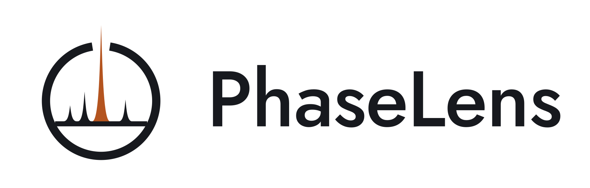
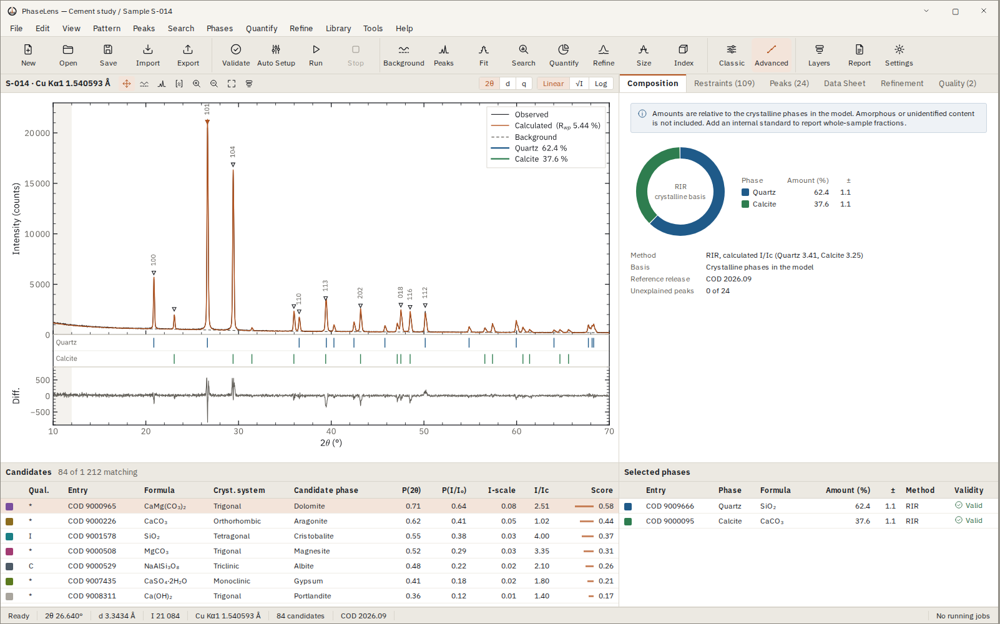
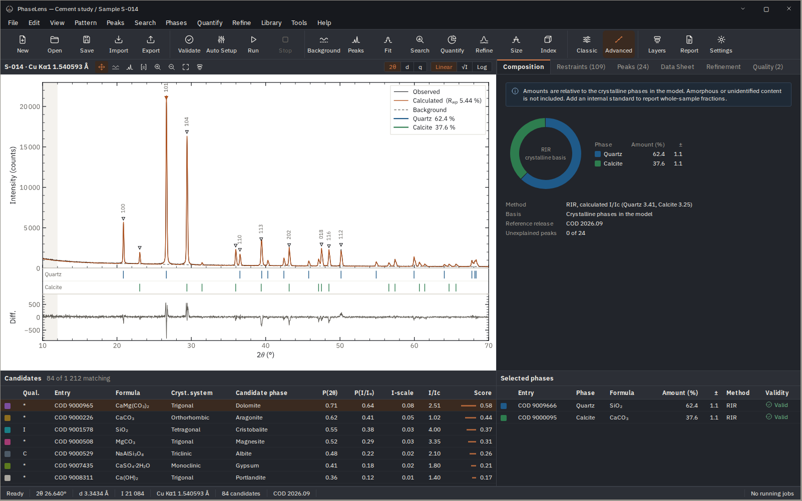
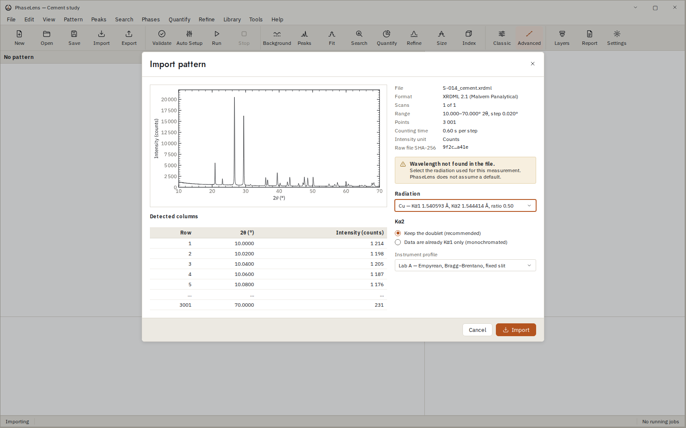
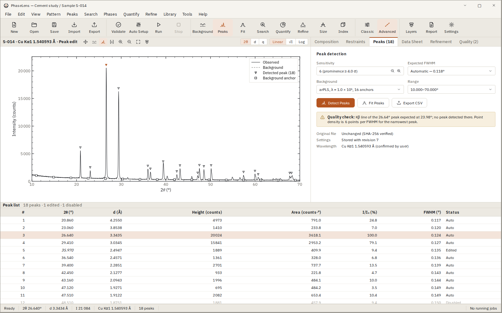
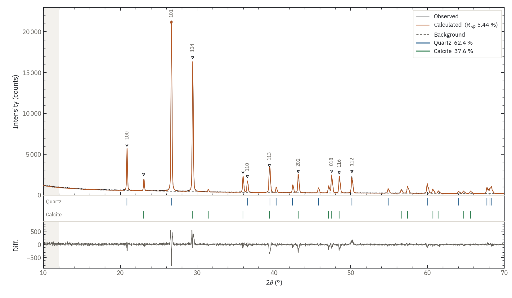

<p align="center">
  
</p>

<h1 align="center">PhaseLens</h1>

<p align="center">
  Powder X-ray diffraction analysis for Windows: import, clean, peak search, phase identification and quantification, with every assumption stated and stored.
</p>

<p align="center">
  <a href="https://github.com/ameenalzubi0-bit/PhaseLens-releases/releases/latest">
    
  </a>
  
  <a href="https://doi.org/10.5281/zenodo.24478793"></a>
  
  
  <a href="https://github.com/ameenalzubi0-bit/PhaseLens-releases/issues">
    
  </a>
</p>

<p align="center">
  <a href="https://github.com/ameenalzubi0-bit/PhaseLens-releases/releases/latest">
    
  </a>
</p>

<p align="center">
  <picture>
    <source media="(prefers-color-scheme: dark)" srcset="https://raw.githubusercontent.com/ameenalzubi0-bit/PhaseLens-releases/main/docs/main-window-dark.png">
    
  </picture>
</p>

<p align="center">
  <a href="#what-the-program-does">Features</a> &nbsp;|&nbsp;
  <a href="#download-and-verify">Download</a> &nbsp;|&nbsp;
  <a href="#validation-results">Validation</a> &nbsp;|&nbsp;
  <a href="#known-limitations">Limitations</a> &nbsp;|&nbsp;
  <a href="#faq">FAQ</a> &nbsp;|&nbsp;
  <a href="https://github.com/ameenalzubi0-bit/PhaseLens-releases/issues/new/choose">Support</a>
</p>

<table align="center">
  <tr>
    <td align="center" width="25%"><b>Offline analysis</b><br><sub>Patterns and results never leave your computer</sub></td>
    <td align="center" width="25%"><b>No silent assumptions</b><br><sub>Radiation, axis and units are never guessed</sub></td>
    <td align="center" width="25%"><b>Reproducible</b><br><sub>Every result stores its settings and versions</sub></td>
    <td align="center" width="25%"><b>Report-ready</b><br><sub>PDF, HTML, JSON, CSV and publication figures</sub></td>
  </tr>
</table>

---

<details>
<summary><b>Table of contents</b></summary>

- [What is PhaseLens?](#what-is-phaselens)
- [What the program does](#what-the-program-does)
- [Principles](#principles)
- [How the methods work](#how-the-methods-work)
- [Screenshots](#screenshots)
- [Validation results](#validation-results)
- [Download and verify](#download-and-verify)
- [System requirements](#system-requirements)
- [Licence and citation](#licence-and-citation)
- [Known limitations](#known-limitations)
- [Roadmap](#roadmap)
- [FAQ](#faq)
- [Developer](#developer)

</details>

## What is PhaseLens?

**PhaseLens** is a free, offline Windows application for **powder X-ray diffraction (XRD)** analysis. It takes a measured pattern, lets you prepare it step by step, finds the peaks, searches a crystallographic reference library for matching phases, estimates phase amounts, and writes a report that records every setting that produced the result.

The interface is a native Windows application (WPF). The scientific calculations run in a separate Python worker process, so the window stays responsive during a long search.

**Who it is for:** materials, geoscience and chemistry researchers, graduate students processing diffractograms for a thesis or paper, and laboratory technicians who need a result they can defend: not only a list of candidate phases, but the exact assumptions behind it.

**What makes it different:** science is never silent. There is no default wavelength, no automatic background subtraction, no clipping of negative values and no "confidence percent" computed from a score. If the radiation source, axis type or intensity type is unknown, PhaseLens keeps it "unknown" and blocks the operations that need it, instead of guessing.

[Back to top](#table-of-contents)

## What the program does

A typical session:

1. **Import** a measured pattern: text files (XY, XYE, CSV, TSV, ASC, DAT, start-step-end text) and Malvern Panalytical XRDML 1.0 to 1.5. The import dialog shows what was read and what is still unknown (radiation, axis, intensity type) and asks you to confirm it.
2. **Prepare** the pattern with processing steps that you apply deliberately, each stored as a new, versioned result: analysis range, background, K-alpha2 stripping, smoothing, zero-shift and sample-displacement correction, slit conversion, and display axis conversion (2-theta, d, q, 1/d).
3. **Detect and fit peaks:** peak detection, then peak fitting with a pseudo-Voigt profile, plus measurement quality control (QC).
4. **Search and match:** peak search-match, strongest-lines search, residual searching and whole-pattern (PFSM) matching against the bundled reference library, with element restraints and presets. The **Advisor** and a guided search workflow suggest the next step and say why.
5. **Quantify** the identified phases by reference intensity ratio (RIR), the internal-standard method, degree of crystallinity, and element-composition comparison.
6. **Report and export:** PDF, HTML, JSON and CSV reports; publication figures (SVG, PDF, PNG, TIFF at 300 or 600 dpi); a generated methods paragraph with citations; data exports; and a reproducibility package.
7. **Re-analyse** a saved project: every stored stage is replayed from the exact request saved with its result, and the report states whether the replay is identical.

Also included: crash recovery, a diagnostics package, a bundled starter reference release built from the Crystallography Open Database (COD), a user library for your own phases (CIF import), a headless command-line tool (`phaselens-cli.exe`), and a signed automatic update check.

[Back to top](#table-of-contents)

## Principles

| Rule | What it means in practice |
|---|---|
| No silent assumptions | Radiation, units, axis type, intensity type and geometry are never assumed. Unknown stays unknown and blocks the steps that need it. |
| Raw data is immutable | Processing creates new versioned results with their parameters, algorithm version and input hashes. Dependent results become stale when an input changes. |
| Reproducible | The same input, settings and versions give the same output within a documented tolerance, and re-analysis checks it. |
| A score is not a probability | Figures of merit are ranking aids. PhaseLens never turns them into a "confidence percent". |
| Refusals are explicit | When a method does not apply (for example fewer than two phases for RIR), PhaseLens refuses with a stated reason instead of returning a number. |
| Display is not calculation | Decimation used for drawing never feeds a calculation. |
| Offline analysis | Your patterns, results and file names never leave the computer. |

[Back to top](#table-of-contents)

## How the methods work

Each scientific feature has a method card (reference, equations, inputs and units, assumptions, refusal cases, uncertainty, test data and validity domain). The main relations are below.

**Bragg's law and axis conversion.** With wavelength `lambda` (angstrom) and diffraction angle `2theta`, `theta = 2theta / 2`:

```math
d = \frac{\lambda}{2\sin\theta}, \qquad
q = \frac{4\pi\sin\theta}{\lambda} = \frac{2\pi}{d}, \qquad
\frac{1}{d} = \frac{2\sin\theta}{\lambda}
```

Known-answer check used in the tests: `lambda = 1.5406 A`, `2theta = 30 deg` gives `d = 2.976211 A` and `q = 2.111136 A^-1`.

**K-alpha2 stripping (Rachinger-type).** The measured net intensity `n` contains the K-alpha1 profile `y1` plus a scaled, shifted copy from K-alpha2 with intensity ratio `R`. The source angle of the K-alpha1 line that produces a point at `x` follows Bragg's law for both lines:

```math
x_1(x) = 2\arcsin\!\left(\frac{\lambda_1}{\lambda_2}\sin\frac{x}{2}\right), \qquad
y_{1,i} = n_i - R\,\big[(1-t)\,y_{1,j} + t\,y_{1,j+1}\big]
```

where `j` is the lower neighbour of `x_1` and `t` the interpolation weight. The background is added back and never changed. References: Rachinger (1948); Delhez and Mittemeijer (1975); Ladell, Zagofsky and Pearlman (1975).

**Quantification by reference intensity ratio.** For selected phases `i = 1..n` (at least two):

```math
S_i = s_i M_i, \qquad q_i = \frac{S_i}{(I/I_c)_i}, \qquad
W_i = 100\,\frac{q_i}{\sum_k q_k}
```

`W_i` is weight percent on the basis of the crystalline phases in the model. It does not exclude amorphous or unidentified content. Reference: Chung, J. Appl. Cryst. 7 (1974) 519-525 and 526-534. Nothing is clipped or rounded, and no negative amount is set to zero.

**Internal standard.** With known standard fraction `s` in the mixture and RIR fraction `r_i` of each phase among the modelled crystalline phases (`r_s` for the standard):

```math
c = \frac{s}{r_s}, \qquad
w_i = \frac{c\,r_i}{1 - s}, \qquad
\text{unaccounted} = \frac{1 - c}{1 - s}
```

`unaccounted` is the amorphous plus unidentified fraction of the original sample. The result is right only when the standard's reference intensity ratio matches the one used.

**Degree of crystallinity (area method).** With the measured intensity `y`, the fitted background `b` and the scaled background height term `k h`:

```math
X_A = 100\,\frac{A_c}{A_t}, \qquad
A_c = \int (y-b)\,d2\theta, \quad
A_t = A_c + A_a, \quad
A_a = \int (b - kh)\,d2\theta
```

The method card stores the integration table and an "unexplained" area so the fraction can be audited.

[Back to top](#table-of-contents)

## Screenshots

<table>
  <tr>
    <td align="center" width="50%"><br><sub>Main window, dark theme</sub></td>
    <td align="center" width="50%"><br><sub>Import dialog: what was read, and what you confirm</sub></td>
  </tr>
  <tr>
    <td align="center" width="50%"><br><sub>Peak list with the detected reflections</sub></td>
    <td align="center" width="50%"><br><sub>Publication plot style: inward ticks, full frame, difference panel, phase tick rows</sub></td>
  </tr>
</table>

The images are the interface design references that the application is built to match.

[Back to top](#table-of-contents)

## Validation results

Release 1.0.0 was checked against published data and an installed run. All numbers below come from the release notes; misses are listed as well.

| Gate | Result |
|---|---|
| Qualitative search, pure-phase test set | Recall@10 = 0.9967 (SE 0.0033), target 0.95 met |
| Quantification, IUCr CPD round robin, samples 1a-1h, set A | Mean absolute error over major phases 2.44 wt%, target 3 wt% met |
| Quantification, same round robin, set B | 3.39 wt%, target missed slightly |
| Performance, 100 000-point pattern open and prepare | 1.06 s cold, 0.35 s warm (met) |
| Performance, first plot frame with 100 000 points | 4.6 s cold: not met (0.10 s warm) |
| Performance, full peak search | 17-32 s cold, 2-5 s warm on single phases: not met |
| Installed application | 33 automated user-interface tests passed against the installed copy; installed command-line tool wrote all four report formats; uninstall kept user data |
| Signed update | 39 of 39 installed update checks passed (offer, download, signature and hash verification, install, relaunch) |

Corundum as a minor phase is overestimated in the round robin (for example 10.3 wt% for 1.15 wt% weighed). Mixtures are found less reliably than single phases (synthetic mixture Recall@10 = 0.51).

[Back to top](#table-of-contents)

## Download and verify

1. Open the [latest release](https://github.com/ameenalzubi0-bit/PhaseLens-releases/releases/latest) and download `PhaseLens-Setup-1.0.1.exe`.
2. Optional check of the download. In PowerShell:

```powershell
(Get-FileHash .\PhaseLens-Setup-1.0.1.exe -Algorithm SHA256).Hash.ToLower()
```

The value must equal the one in `SHA256SUMS`:

```text
d87c078828cc2c03713f3aaabd5b47dbbf6c3594abcb1691d76e6b0ab2dee1b4  PhaseLens-Setup-1.0.1.exe
```

`SHA256SUMS` is signed (RSA 3072, SHA-256) and `SHA256SUMS.sig` is the signature. The program verifies the same signature before it installs an update; a download that fails the check is deleted.

3. Run the setup. It installs per user. The first start unpacks the bundled reference release (about 209 000 files, 1.36 GB) and takes a few minutes.
> [!NOTE]
> Installation and activation need an internet connection. The first start unpacks the reference release and takes a few minutes.

4. Enter the serial key you received and activate online (see [Licence](#licence-and-citation)).

**Updates.** On each start PhaseLens asks this repository for the latest release in the background and offers the new version if there is one. No licence, hardware, project or setting data is sent. The check can be turned off in Options, and Help > Check for updates runs it on demand.

[Back to top](#table-of-contents)

## System requirements

| | |
|---|---|
| Operating system | Windows 10 or 11, 64-bit |
| Disk | About 560 MB for the setup, plus 1.36 GB for the unpacked reference release |
| Memory | Developed and timed on 4 GB RAM; more is better for large patterns |
| Network | Needed for installation, activation, a licence check at least every 14 days, and the update check. Analysis itself works offline |
| Optional | Microsoft Visual C++ 2015-2022 runtime, needed only to import a CIF into the user library |

[Back to top](#table-of-contents)

## Licence and citation

PhaseLens 1.0.0 is free and closed source, released under the **PhaseLens Closed Beta License v1.0** (shown in the installer and at first start). Each serial key is issued to one person and activates one computer. Exported files and saved projects carry a watermark (licence ID, version, analysis date, file fingerprint), and reports show "Licensed to: name".

If you use PhaseLens in your work, please cite it (Help > About PhaseLens > Copy citation):

> Al-Zu'bi, A. A. A. PhaseLens: X-ray diffraction analysis software, version 1.0.1. https://doi.org/10.5281/zenodo.24478793

Third-party components keep their own licences; the installed folder holds `licenses/THIRD-PARTY-NOTICES.txt`.

[Back to top](#table-of-contents)

## Known limitations

These are stated in the release notes and kept visible on purpose.

- Mixtures are found less reliably than single phases, and the score column is titled "Score (preview)". A score is a ranking aid, not a probability.
- Peak-list RIR is biased for complex phases with overlapping peaks; whole-pattern methods are planned for v1.5.
- Normalised fractions do not exclude amorphous content. Only an internal standard or the degree of crystallinity measures it.
- Peak search and the first plot frame miss their speed targets on the reference machine (an Intel i7-3540M with 4 GB RAM). Results are identical; only the time is longer.
- Bruker and Rigaku raw formats are not read in 1.0. Import them as XY or XRDML.
- No detection limit (LOD/LOQ) and no bootstrap uncertainty yet.
- Installation and activation cannot be done offline.

[Back to top](#table-of-contents)

## Roadmap

- **v1.5:** Rietveld and Le Bail refinement through a user-installed GSAS-II connector, and crystallite size with instrument broadening.
- **v2.0:** indexing, structure viewer, recipes, batch processing, folder watch, teaching mode.
- **Later:** FullProf, BGMN and ICDD connectors.

[Back to top](#table-of-contents)

## FAQ

<details>
<summary><b>Does PhaseLens send my data anywhere?</b></summary>

No XRD data, results or file names leave the computer. The program contacts only the licensing service (installation check, activation, periodic check, feedback you send, optional anonymous statistics) and this repository (update check and download).

</details>

<details>
<summary><b>Why does it ask for the radiation source?</b></summary>

Converting 2-theta to d or q, and every search, depends on the wavelength. PhaseLens will not assume one.

</details>

<details>
<summary><b>Why does the Report dialog have no page preview?</b></summary>

It is not built in 1.0. Open the written HTML or PDF to check it.

</details>

<details>
<summary><b>Can I trust the percentages?</b></summary>

Phase fractions are estimates with the stated assumptions and a stated uncertainty. A set of fractions that sums to 100 percent does not prove the absence of amorphous content.

</details>

<details>
<summary><b>I found a problem.</b></summary>

Open an [issue](https://github.com/ameenalzubi0-bit/PhaseLens-releases/issues) and attach the diagnostics package (Help menu).

</details>

[Back to top](#table-of-contents)

## Developer

Developed by **Amin Ahmad Amin Al-Zu'bi**, Amman, Jordan. The source code is private; this repository holds the installers and release files only.

[Back to top](#table-of-contents)
